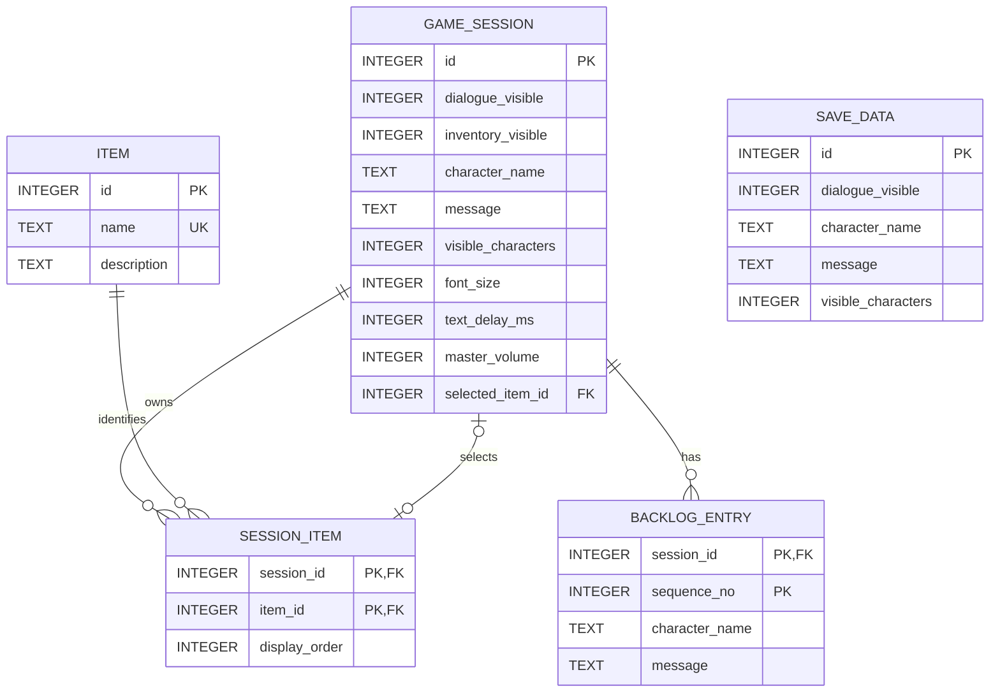

# ノベルゲーム DB設計書

## 1. 目的と前提

本書は [仕様書](SPECIFICATION.md) の機能をデータベースで扱う場合の設計案です。現在の実装はDBを使用せず、セーブにはホームディレクトリの `.novel-game-save.properties` を使用しています。本書はDBの導入・移行を実施するものではありません。

単一ユーザーのデスクトップアプリを前提に、組み込み型の SQLite を想定します。DBファイルはアプリケーションが読み書きできる場所に配置するものとし、具体的なパスは導入時に決定します。SQLite の各接続では外部キー制約を有効にします（`PRAGMA foreign_keys = ON`）。

現行仕様に合わせ、セーブは1件のみとし、保存対象は会話表示状態の4項目です。設定・所持アイテム・アイテム選択・バックログは、下記の一時データとしてDBに保持できる設計としますが、セーブデータの復元対象には含めません。アプリ終了時に削除できなかった場合も、次回起動時に一時データを初期化します。シナリオ進行、選択肢、画像・音声の管理は対象外です。

## 2. テーブル一覧

| テーブル | 用途 | 保持期間 |
| --- | --- | --- |
| `item` | アイテム名・説明のマスタ | 永続 |
| `game_session` | 現在の画面状態と設定 | 起動中のみ |
| `session_item` | 現在の所持アイテム | 起動中のみ |
| `backlog_entry` | 現在の会話履歴 | 起動中のみ |
| `save_data` | 会話状態のセーブデータ | 永続 |

`game_session` は単一インスタンスの現在状態を表し、`id = 1` の行を起動時に作成します。`save_data` も `id = 1` に限定し、行が存在しなければ未セーブと判断します。設定はセーブデータではなく `game_session` に格納します。

## 3. ER図

`SAVE_DATA` は独立したスナップショットです。セッションの削除や再作成によって消えないため、セッションへの外部キーを持ちません。図中の選択関係は `game_session(id, selected_item_id)` から `session_item(session_id, item_id)` への複合外部キーで表します。`selected_item_id` が NULL の場合は未選択です。

## 4. テーブル定義

型は SQLite の `INTEGER`、`TEXT` を使用します。真偽値は `INTEGER` の `0`／`1` とし、各列は NULL 可と明記した場合を除き `NOT NULL` です。`PK` は主キー、`FK` は外部キー、`UK` は一意制約を示します。

### 4.1 `item`（アイテムマスタ）

| 列名 | 型 | 制約 | 内容 |
| --- | --- | --- | --- |
| `id` | INTEGER | PK | アイテムID |
| `name` | TEXT | UK、空文字不可 | アイテム名 |
| `description` | TEXT | 空文字不可 | 詳細説明 |

初期データは次のとおりです。IDは固定値として参照します。

| ID | 名前 | 説明 |
| ---: | --- | --- |
| 1 | 古い鍵 | 錆びているが、まだ何かを開けられそうだ。 |
| 2 | 月の欠片 | 淡い光を放つ、半透明な欠片。 |

### 4.2 `game_session`（現在のゲーム状態）

| 列名 | 型 | 制約・初期値 | 内容 |
| --- | --- | --- | --- |
| `id` | INTEGER | PK、`CHECK (id = 1)` | 固定ID |
| `dialogue_visible` | INTEGER | 初期値 `1`、0 または 1 | 会話ウィンドウの表示状態 |
| `inventory_visible` | INTEGER | 初期値 `0`、0 または 1 | アイテム一覧の表示状態 |
| `character_name` | TEXT | 初期値 `キャラクター` | 現在の話者名 |
| `message` | TEXT | 初期値 `ここにセリフを表示します。` | 現在のメッセージ全文 |
| `visible_characters` | INTEGER | 初期値 `0`、0 以上 | 表示済み文字数 |
| `font_size` | INTEGER | 初期値 `20`、18～32 | 会話文字サイズ（px） |
| `text_delay_ms` | INTEGER | 初期値 `35`、10～150 | 文字送り間隔（ms）。10 は即時表示 |
| `master_volume` | INTEGER | 初期値 `80`、0～100 | 音量（%） |
| `selected_item_id` | INTEGER | NULL 可、複合 FK | 選択中アイテムのID。未選択は NULL |

複合外部キーは `(id, selected_item_id) REFERENCES session_item(session_id, item_id)` とし、選択できるアイテムを現在の所持品に限定します。所持品を削除する前に選択を解除します。セッション作成時は選択IDを NULL とし、続けて所持品を登録します。

### 4.3 `session_item`（所持アイテム）

| 列名 | 型 | 制約 | 内容 |
| --- | --- | --- | --- |
| `session_id` | INTEGER | PK、FK | 所持するセッションのID |
| `item_id` | INTEGER | PK、FK | アイテムID |
| `display_order` | INTEGER | 0 以上、セッション内で一意 | 一覧の表示順 |

主キーは `(session_id, item_id)`、表示順は `UNIQUE (session_id, display_order)` とします。初期状態は「古い鍵」を 0、「月の欠片」を 1 とします。同一アイテムは1件のみ保持し、数量は管理しません。

### 4.4 `backlog_entry`（会話履歴）

| 列名 | 型 | 制約 | 内容 |
| --- | --- | --- | --- |
| `session_id` | INTEGER | PK、FK | 履歴を所有するセッションのID |
| `sequence_no` | INTEGER | PK、0 以上 | セッション内の表示順 |
| `character_name` | TEXT | | 記録時の話者名 |
| `message` | TEXT | | 記録時のメッセージ全文 |

主キーは `(session_id, sequence_no)` です。初期化時に初期会話を順序 0 として登録し、`sequence_no` 昇順で表示します。現行実装には初期会話以降の追加処理はありません。

### 4.5 `save_data`（セーブデータ）

| 列名 | 型 | 制約 | 現行保存キーとの対応 |
| --- | --- | --- | --- |
| `id` | INTEGER | PK、`CHECK (id = 1)` | 固定ID |
| `dialogue_visible` | INTEGER | 0 または 1 | `dialogueVisible` |
| `character_name` | TEXT | | `characterName` |
| `message` | TEXT | | `message` |
| `visible_characters` | INTEGER | 0 以上 | `visibleCharacters` |

文字数は現行Java実装に合わせ、UTF-16コード単位で扱います。アプリケーション側で `visible_characters <= message.length()` を検証し、ロード時は現行実装と同様に 0～全文の長さへ丸めます。SQLite の `length()` は補助文字の数え方がJavaと異なるため、この上限には使用しません。

## 5. リレーションと整合性

| 親 | 子 | 関係 | 外部キーと削除時の扱い |
| --- | --- | --- | --- |
| `game_session` | `session_item` | 1 対 0以上 | `session_item.session_id` → `game_session.id`、`ON DELETE CASCADE` |
| `item` | `session_item` | 1 対 0以上 | `session_item.item_id` → `item.id`、`ON DELETE RESTRICT` |
| `game_session` | `backlog_entry` | 1 対 0以上 | `backlog_entry.session_id` → `game_session.id`、`ON DELETE CASCADE` |
| `session_item` | `game_session` の選択 | 所持品1件に対して選択0または1件 | `(game_session.id, selected_item_id)` → `(session_item.session_id, item_id)`、`ON DELETE RESTRICT` |

セッション削除時は循環参照を避けるため、同一トランザクション内で選択を NULL にしてから `game_session` を削除します。マスタのアイテムIDは変更しません。複合主キーと表示順の一意制約は、各セッションのアイテム・履歴取得に必要なインデックスとしても利用します。

## 6. 主要処理

| 処理 | DB操作・結果 |
| --- | --- |
| 起動 | 残存する一時セッションを選択解除後に削除し、初期値で `game_session`、初期所持品、初期履歴を作成する。設定は初期値へ戻る |
| 設定変更 | `game_session` の設定値を更新し、画面へ即時反映する |
| アイテム表示・選択 | `session_item` を `item` と結合して表示順に取得し、選択時は `selected_item_id` を更新する |
| バックログ表示 | `backlog_entry` を `sequence_no` 昇順で取得する |
| セーブ | `game_session` の会話状態4項目を `save_data` の `id = 1` に挿入または上書きする |
| ロード | `save_data` がなければ未セーブを通知する。存在すれば4項目を現在のセッションへ反映し、未表示の文字があれば表示を再開する |
| 終了 | 選択解除後に `game_session` を削除する。所持品と履歴は連鎖削除し、セーブとアイテムマスタは保持する |

セーブ・ロード、起動時の初期化、終了時の削除はそれぞれトランザクション単位とし、失敗時はロールバックして利用者に通知します。ロードは設定、所持品、アイテム選択、アイテム一覧の表示状態、バックログを変更しません。タイトル画面からの「はじめから」は現行仕様どおり現在のセッションを表示し、再初期化しません。

## 7. 導入時の確認事項

- SQLite JDBC ドライバーの導入、DBファイルの配置・アクセス権、DB接続処理は別途実装が必要です。
- 既存の Properties セーブデータを自動移行する処理は現時点ではありません。移行する場合は4項目を検証し、既存ファイルを保持したうえで `save_data` へ取り込む方針とします。
- DBファイルの作成・更新に失敗した場合の通知と、スキーマ変更時のバージョン管理を実装時に用意します。
